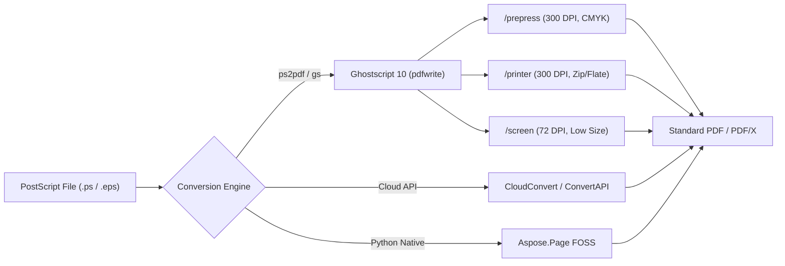

<div align="center">



# 📄 Awesome PostScript To PDF Converter 🚀

**A curated directory of SaaS platforms, Ghostscript-powered batch pipelines, Distiller-compatible tools, and open-source PostScript (`.ps`), Encapsulated PostScript (`.eps`), and PDF converters.**

<p align="center">
  <a href="https://github.com/ishandutta2007/Awesome-Awesome-Awesome"></a>
  <a href="https://discord.gg/jc4xtF58Ve"></a>
  <a href="https://github.com/ishandutta2007/Awesome-Postscript-To-PDF-Converter/stargazers"></a>
  <a href="https://github.com/ishandutta2007/Awesome-Postscript-To-PDF-Converter/network/members"></a>
  <a href="https://github.com/ishandutta2007/Awesome-Postscript-To-PDF-Converter/blob/main/LICENSE"></a>
  <a href="https://github.com/ishandutta2007/Awesome-Postscript-To-PDF-Converter/pulls"></a>
  <a href="https://github.com/ishandutta2007"></a>
</p>

</div>

---

## 📑 Table of Contents
- [📌 Overview & SEO Summary](#-overview--seo-summary)
- [🌐 Sector Overview & Market Dynamics](#-sector-overview--market-dynamics)
- [☁️ SaaS & Hosted Conversion Platforms](#️-saas--hosted-conversion-platforms)
- [💻 Open-Source GitHub Projects](#-open-source-github-projects)
  - [1. ImageMagick](#1-imagemagick-)
  - [2. PyMuPDF](#2-pymupdf-)
  - [3. QPDF](#3-qpdf-)
  - [4. MuPDF](#4-mupdf-)
  - [5. dvisvgm](#5-dvisvgm-)
  - [6. Ghostscript & ps2pdf (GhostPDL)](#6-ghostscript--ps2pdf-ghostpdl-)
  - [7. cups-filters (pstopdf)](#7-cups-filters-pstopdf-)
  - [8. psutils](#8-psutils-)
  - [9. pstoedit](#9-pstoedit-)
  - [10. Aspose.Page FOSS for Python](#10-asposepage-foss-for-python-)
- [🛠️ Architecture & Conversion Recipes](#️-architecture--conversion-recipes)
- [❓ Frequently Asked Questions (FAQ)](#-frequently-asked-questions-faq)
- [🤝 How to Contribute](#-how-to-contribute)
- [📈 Star History](#-star-history)
- [💖 Support & Sponsorship](#-support--sponsorship)
- [⚖️ Disclaimer & License](#️-disclaimer--license)

---

## 📌 Overview & SEO Summary

The **PostScript to PDF converter ecosystem** powers modern prepress publishing, automated print spooling, and digital document archiving. When migrating legacy print files (`.ps`, `.eps`, `.prn`) into searchable, web-optimized, and standard-compliant **PDF** documents (such as **PDF/X-1a**, **PDF/X-4** for commercial printing, and **PDF/A-1b** for long-term preservation), engineering teams face a spectrum of solutions ranging from enterprise cloud REST APIs to command-line Ghostscript (`ps2pdf`) pipelines.

### 🎯 Key Search Topics & Capabilities
- **PostScript to PDF Conversion (`PS to PDF` / `EPS to PDF`)**: Preserves vector graphics paths, embedded Type 1 / TrueType / OpenType fonts, CMYK/Pantone color separation tables, and raster resolution.
- **Adobe Acrobat Distiller Parameters**: Emulates Distiller job options (`-dPDFSETTINGS=/prepress`, `-dEmbedAllFonts=true`, `-dCompatibilityLevel=1.4`, `-dColorConversionStrategy=/LeaveColorUnchanged`).
- **Batch CLI Automation**: Scalable self-hosted Linux, Windows, and macOS command-line pipelines for continuous PDF generation.
- **Developer REST APIs**: High-throughput multi-tenant cloud document conversion with webhooks, SDKs, and zero infrastructure overhead.

---

## 🌐 Sector Overview & Market Dynamics

The global **document conversion and PDF software market** is estimated at **$2.5 billion in 2025** and is projected to expand to **$4.1 billion by 2030**, reflecting a compound annual growth rate (**CAGR**) of **10.5%–11.5%**. Growth is fueled by enterprise cloud migration, digital paperless compliance, automated publishing workflows, and AI-assisted document ingestion pipelines.

From a market dynamics perspective, the sector exhibits a **bifurcated, moderately concentrated structure**:
1. **Commercial & Prepress Printing (Concentrated / Winner-Take-Most)**: Dominated by **Adobe Inc.** via Acrobat Distiller, the PostScript reference standard, and proprietary RIP (Raster Image Processor) licensing, where contractual PDF/X compliance and brand inertia create extremely high switching costs.
2. **Cloud Conversion APIs & Self-Hosted Automation (Moderately Fragmented)**: Highly competitive and fragmented across specialized cloud SaaS conversion providers (CloudConvert, Aspose Cloud, ConvertAPI, Zamzar) and open-source infrastructure centered on **Artifex Ghostscript**, **CUPS filters**, and Python processing libraries competing on API ergonomics, throughput pricing, and licensing flexibility (AGPL vs. Commercial).

---

## ☁️ SaaS & Hosted Conversion Platforms

Below is a detailed comparison of leading commercial SaaS products and cloud conversion APIs supporting PostScript (`.ps`) and Encapsulated PostScript (`.eps`) to PDF transformation.

> **Sorted by Company Scale (Valuation / Revenue) descending:**

| 🏢 Product / Provider | 📊 Company Scale (Valuation / Revenue) | 💳 Starting Tier Pricing | 🎁 Free Tier Limit | 🌟 Primary Capabilities & Best For |
| :--- | :--- | :--- | :--- | :--- |
| **[Adobe Acrobat Distiller / PDF Services](https://www.adobe.com/acrobat.html)** | **~$100B–$146B Market Cap**<br>*(~$23.8B FY2025 Revenue)* | **$19.99 / month** *(Acrobat Pro annual plan, paid monthly)* or **$0.05 / call** *(PDF Services API pay-as-you-go)* | **7-day free trial** *(Acrobat Pro with full Distiller feature set)* or **500 free document transactions/month forever** *(PDF Services API)* | 🖨️ Reference PostScript-to-PDF engine. Complete control over Distiller `.joboptions`, CMYK/spot color management, and ISO PDF/X-1a/PDF/X-4 print prepress compliance. |
| **[Aspose.Page Cloud](https://products.aspose.cloud/page/)** | **~$35M–$50M**<br>*(Estimated Annual Revenue)* | **$30.00 / month flat rate** *(Metered tier including first 1,000 document processing credits, then $0.03/credit)* | **150 free credits / API calls per month forever** *(Full features enabled with zero watermarks)* | ☁️ Multi-platform REST API (Python, C#, Java, Node.js) for PS, EPS, and XPS to PDF conversion with cloud storage connectors (S3, Dropbox, Azure Blob). |
| **[CloudConvert](https://cloudconvert.com/ps-to-pdf)** | **~$7M–$10M**<br>*(Estimated Annual Revenue)* | **$9.00 / month** *(Subscription for 1,000 conversion credits)* or **$17.00 one-time** *(1,000 prepaid package credits, non-expiring)* | **10 conversion credits per day forever** *(Max 1 GB file size, up to 5 concurrent conversions, 5 min processing timeout)* | ⚡ High-reliability cloud conversion API supporting PostScript/EPS with fine-grained Ghostscript engine parameters, webhook callbacks, and SDKs. |
| **[Zamzar API](https://developers.zamzar.com/)** | **~$4M–$6M**<br>*(Estimated Annual Revenue)* | **$9.00 / month** *(Developer Tier: 500 conversion credits at $0.018/conversion; Web Pro plan starts at $9.00/month)* | **2 file conversions per 24 hours forever** *(Web tool, max 50 MB)* or **100 free test conversion credits** *(Developer API sandbox environment)* | 🔄 Multi-format conversion platform offering synchronous and asynchronous endpoints for batch PS/EPS translation into web-ready PDFs. |
| **[novaPDF](https://www.novapdf.com/)** | **~$3M–$5M**<br>*(Estimated Annual Revenue)* | **$29.99 one-time** *(novaPDF Lite perpetual license, lifetime validity for major version; Standard $39.99, Pro $49.99)* | **30-day fully functional free trial** *(All features unlocked across Lite, Standard, and Pro; appends a footer evaluation notice)* | 🖥️ Commercial Windows virtual printer driver and COM/SDK interface for converting PostScript output streams into secure, password-protected PDFs. |
| **[ConvertAPI](https://www.convertapi.com/ps-to-pdf)** | **~$2.5M–$4M**<br>*(Estimated Annual Revenue)* | **$35.00 / month** *(Developer plan: 1,000 conversions/month)* or **$15.00 one-time** *(Prepaid package: 250 conversions)* | **250 free conversion credits** *(One-time 30-day evaluation trial upon registration, no credit card required)* | 🚀 Fast, high-throughput REST API designed for microservices, supporting PS to PDF/A compliance, vector preservation, and Zapier/Make integrations. |

---

## 💻 Open-Source GitHub Projects

Open-source utilities form the backbone of automated document pipelines. Below is a curated, comprehensive index of open-source PostScript and PDF conversion repositories, **sorted by GitHub Star Count (descending)**.

| 🏆 Rank | 📦 Project | ⭐ GitHub Stars (Social Badge) | 🔀 Stargazers Link | 📜 License | 🛠️ Core Purpose |
| :---: | :--- | :---: | :---: | :---: | :--- |
| **1** | [ImageMagick](https://github.com/ImageMagick/ImageMagick) | [](https://github.com/ImageMagick/ImageMagick/stargazers) | [View Stargazers](https://github.com/ImageMagick/ImageMagick/stargazers) | Apache-2.0 | Swiss-army knife image & PS/EPS to PDF CLI conversion |
| **2** | [PyMuPDF](https://github.com/pymupdf/PyMuPDF) | [](https://github.com/pymupdf/PyMuPDF/stargazers) | [View Stargazers](https://github.com/pymupdf/PyMuPDF/stargazers) | AGPL-3.0 / Commercial | High-performance Python rendering & document conversion |
| **3** | [QPDF](https://github.com/qpdf/qpdf) | [](https://github.com/qpdf/qpdf/stargazers) | [View Stargazers](https://github.com/qpdf/qpdf/stargazers) | Apache-2.0 | Post-conversion PDF structural optimization & linearization |
| **4** | [MuPDF](https://github.com/ArtifexSoftware/mupdf) | [](https://github.com/ArtifexSoftware/mupdf/stargazers) | [View Stargazers](https://github.com/ArtifexSoftware/mupdf/stargazers) | AGPL-3.0 / Commercial | Ultra-fast, lightweight C document and vector graphics engine |
| **5** | [dvisvgm](https://github.com/mgieseki/dvisvgm) | [](https://github.com/mgieseki/dvisvgm/stargazers) | [View Stargazers](https://github.com/mgieseki/dvisvgm/stargazers) | GPL-3.0 | Fast DVI, EPS, and PostScript vector parser & converter |
| **6** | [Ghostscript & ps2pdf](https://github.com/ArtifexSoftware/ghostpdl) | [](https://github.com/ArtifexSoftware/ghostpdl/stargazers) | [View Stargazers](https://github.com/ArtifexSoftware/ghostpdl/stargazers) | AGPL-3.0 / Commercial | The foundational PostScript interpreter & `ps2pdf` engine |
| **7** | [cups-filters](https://github.com/OpenPrinting/cups-filters) | [](https://github.com/OpenPrinting/cups-filters/stargazers) | [View Stargazers](https://github.com/OpenPrinting/cups-filters/stargazers) | Apache-2.0 / MIT | Linux/UNIX CUPS print spooling filter (`pstopdf`) |
| **8** | [psutils](https://github.com/rrthomas/psutils) | [](https://github.com/rrthomas/psutils/stargazers) | [View Stargazers](https://github.com/rrthomas/psutils/stargazers) | GPL-3.0 | PostScript document manipulation, imposition & layout |
| **9** | [pstoedit](https://github.com/woglu/pstoedit) | [](https://github.com/woglu/pstoedit/stargazers) | [View Stargazers](https://github.com/woglu/pstoedit/stargazers) | GPL-2.0 | PostScript and PDF translator into editable vector formats |
| **10** | [Aspose.Page FOSS for Python](https://github.com/aspose-page-foss/Aspose.Page-FOSS-for-Python) | [](https://github.com/aspose-page-foss/Aspose.Page-FOSS-for-Python/stargazers) | [View Stargazers](https://github.com/aspose-page-foss/Aspose.Page-FOSS-for-Python/stargazers) | MIT | Pure-Python PS/EPS/XPS to PDF without external C libraries |

---

### 1. [ImageMagick](https://github.com/ImageMagick/ImageMagick) [](https://github.com/ImageMagick/ImageMagick/stargazers)
- **Engine Overview**: The gold standard across Unix/Linux environments for image and vector document manipulation. It handles PostScript (`.ps`) and Encapsulated PostScript (`.eps`) input by delegating to Ghostscript behind the scenes and outputting clean, vectorized or rasterized PDF files.
- **Conversion Command**:
  ```bash
  magick -density 300 input.ps -quality 100 output.pdf
  ```
- **Key Strengths**: Unrivaled format support (200+ formats), built-in color profiling, density/DPI manipulation, and automatic multi-page PostScript handling.
- **Caveat**: Requires Ghostscript installed on the host system; security policies (`policy.xml`) may disable PS/EPS rendering by default due to historical PostScript interpreter vulnerabilities.

---

### 2. [PyMuPDF](https://github.com/pymupdf/PyMuPDF) [](https://github.com/pymupdf/PyMuPDF/stargazers)
- **Engine Overview**: High-performance Python bindings for MuPDF. PyMuPDF provides blazing-fast document rendering, conversion, page merging, and text/vector extraction.
- **Conversion Command**:
  ```python
  import fitz # PyMuPDF
  doc = fitz.open("input.xps") # or input documents supported
  doc.save("output.pdf", garbage=4, deflate=True)
  ```
- **Key Strengths**: Extremely rapid execution speeds, rich Pythonic API, zero external subprocess overhead, and minimal memory footprint.
- **Caveat**: Focuses primarily on PDF/XPS rendering; for raw legacy PostScript (`.ps`), it pairs best with a Ghostscript pre-processing step.

---

### 3. [QPDF](https://github.com/qpdf/qpdf) [](https://github.com/qpdf/qpdf/stargazers)
- **Engine Overview**: A structural, content-preserving PDF transformation tool. While Ghostscript converts PostScript into PDF, QPDF acts as the essential post-processor to linearize (web-optimize), encrypt, decrypt, and sanitize generated PDF streams.
- **Conversion Command**:
  ```bash
  qpdf --linearize input-from-ps.pdf optimized-output.pdf
  ```
- **Key Strengths**: Preserves PDF object structures without re-rasterizing vector elements or modifying page streams; fixes damaged PDF object xref tables.
- **Caveat**: Does not parse PostScript directly; it is designed to operate on the output generated by `ps2pdf` or Ghostscript.

---

### 4. [MuPDF](https://github.com/ArtifexSoftware/mupdf) [](https://github.com/ArtifexSoftware/mupdf/stargazers)
- **Engine Overview**: Artifex's lightweight, modular C library for PDF, XPS, and graphics rendering. MuPDF features its own anti-aliased graphics renderer designed for high fidelity and embedded devices.
- **Conversion Command**:
  ```bash
  mutool convert -o output.pdf input.xps
  ```
- **Key Strengths**: Exceptional rendering fidelity, low memory footprint, compact binary size suitable for mobile/embedded targets.
- **Caveat**: Does not natively interpret PostScript language operators; Artifex specifically designates Ghostscript for PostScript workflows.

---

### 5. [dvisvgm](https://github.com/mgieseki/dvisvgm) [](https://github.com/mgieseki/dvisvgm/stargazers)
- **Engine Overview**: A command-line utility that converts DVI, EPS, and PostScript files into clean SVG and PDF vector formats. Widely used in the TeX Live and LaTeX publishing ecosystems.
- **Conversion Command**:
  ```bash
  dvisvgm --eps --pdf input.eps -o output.pdf
  ```
- **Key Strengths**: Flawless font conversion (Type 1, TrueType, CFF to vector glyphs), lossless curve transformation, and native EPS support.
- **Caveat**: Specialized for mathematical and TeX publishing; not designed as a general-purpose multi-page printer driver.

---

### 6. [Ghostscript & ps2pdf (GhostPDL)](https://github.com/ArtifexSoftware/ghostpdl) [](https://github.com/ArtifexSoftware/ghostpdl/stargazers)
- **Engine Overview**: The foundational, industry-standard PostScript interpreter and PDF generator in open-source. Current stable release **Ghostscript 10.08** features hardened PostScript operator isolation (`-dSAFER`), device protection, and complete Distiller parameter mappings via the `pdfwrite` device.
- **Conversion Command**:
  ```bash
  # Distiller prepress preset via ps2pdf wrapper
  ps2pdf -dPDFSETTINGS=/prepress -dEmbedAllFonts=true input.ps output.pdf

  # Direct Ghostscript invocation
  gs -sDEVICE=pdfwrite -dCompatibilityLevel=1.4 -dPDFSETTINGS=/printer \
     -dNOPAUSE -dQUIET -dBATCH -sOutputFile=output.pdf input.ps
  ```
- **Key Strengths**: Full Turing-complete PostScript language interpreter; documented work-alike for Adobe Distiller; supports PDF/X and PDF/A compilation.
- **Caveat**: Command-line flag complexity can be daunting; AGPL-3.0 licensing requires commercial licensing for proprietary redistribution.

---

### 7. [cups-filters (pstopdf)](https://github.com/OpenPrinting/cups-filters) [](https://github.com/OpenPrinting/cups-filters/stargazers)
- **Engine Overview**: The printing filter pipeline maintained by OpenPrinting. Contains the canonical `pstopdf` filter that processes PostScript print jobs sent to CUPS and converts them to PDF before rasterization.
- **Conversion Command**:
  ```bash
  /usr/lib/cups/filter/pstopdf job-id user title copies options < input.ps > output.pdf
  ```
- **Key Strengths**: Directly integrated into Linux and BSD printing architectures; optimized for unattended system daemon execution.
- **Caveat**: Tightly coupled with the CUPS print spooling environment and environment variables.

---

### 8. [psutils](https://github.com/rrthomas/psutils) [](https://github.com/rrthomas/psutils/stargazers)
- **Engine Overview**: A suite of utilities for manipulating PostScript documents prior to conversion, including page selection (`psselect`), n-up imposition (`psnup`), booklet page reordering (`psbook`), and page resizing (`psresize`).
- **Conversion Command**:
  ```bash
  psnup -2 input.ps | ps2pdf - output_2up.pdf
  ```
- **Key Strengths**: Lightweight, standard POSIX pipe-friendly tools for pre-flight document layout and imposition.
- **Caveat**: Operates at the PostScript DSC (Document Structuring Conventions) level; requires standard conformant PS files.

---

### 9. [pstoedit](https://github.com/woglu/pstoedit) [](https://github.com/woglu/pstoedit/stargazers)
- **Engine Overview**: A translator that converts PostScript and PDF graphics into various vector formats editable in drawing tools (SVG, DXF, WMF, Illustrator, and PDF vector structures).
- **Conversion Command**:
  ```bash
  pstoedit -f pdf input.ps output.pdf
  ```
- **Key Strengths**: Extracts vector primitives (lines, Bézier curves, text polygons) and outputs clean structured formats for CAD and graphics tools.
- **Caveat**: Requires Ghostscript binary installed as an external prerequisite; focused on vector translation rather than prepress joboptions.

---

### 10. [Aspose.Page FOSS for Python](https://github.com/aspose-page-foss/Aspose.Page-FOSS-for-Python) [](https://github.com/aspose-page-foss/Aspose.Page-FOSS-for-Python/stargazers)
- **Engine Overview**: A 100% pure-Python library for reading, manipulating, and converting PS, EPS, and XPS documents to PDF without external C libraries or system dependencies. Includes Model Context Protocol (MCP) tool integration.
- **Conversion Command**:
  ```python
  from aspose.page import PsDocument, PdfSaveOptions

  with open("input.ps", "rb") as ps_stream:
      doc = PsDocument(ps_stream)
      options = PdfSaveOptions(suppress_errors=True)
      with open("output.pdf", "wb") as pdf_stream:
          doc.save_as_pdf(pdf_stream, options)
  ```
- **Key Strengths**: Pure Python with simple `pip install`; incorporates Vatti polygon clipping; native AI-agent MCP tools (`ps_to_pdf`).
- **Caveat**: Newer project with narrower scope; does not parse pre-existing PDFs.

---

## 🛠️ Architecture & Conversion Recipes

### ⚡ Distiller Parameter Mapping Cheat-Sheet
When converting PostScript files, matching Adobe Distiller presets ensures correct output resolution, font embedding, and color balance:



### 💡 Common Ghostscript Production Presets
```bash
# 1. Commercial Prepress & Print Publishing (High Quality)
gs -sDEVICE=pdfwrite -dCompatibilityLevel=1.4 -dPDFSETTINGS=/prepress \
   -dEmbedAllFonts=true -dSubsetFonts=true -dAutoRotatePages=/None \
   -dNOPAUSE -dQUIET -dBATCH -sOutputFile=print_ready.pdf input.ps

# 2. Optimized Web Distribution (Small Size)
gs -sDEVICE=pdfwrite -dCompatibilityLevel=1.5 -dPDFSETTINGS=/ebook \
   -dCompressFonts=true -dNOPAUSE -dQUIET -dBATCH \
   -sOutputFile=web_optimized.pdf input.ps

# 3. Converting EPS with BoundingBox Preservation
ps2pdf -dEPSCrop input.eps output.pdf
```

---

## ❓ Frequently Asked Questions (FAQ)

### ❓ What is the difference between PostScript (`.ps`) and PDF?
PostScript is a full, Turing-complete programming language developed by Adobe in 1982 that tells a printer *how* to draw a page using code and loops. PDF (Portable Document Format) is a declarative, structured document format designed in 1993 that represents the *final evaluated state* of the page, eliminating arbitrary script execution while enabling indexing, hyperlinks, and security.

### ❓ How do I fix the "PostScript delegate failed" error in ImageMagick?
ImageMagick restricts PostScript and EPS conversion by default for security (`CVE-2018-16509`). To enable it safely with Ghostscript 10+:
1. Open your `policy.xml` file (typically in `/etc/ImageMagick-7/policy.xml`).
2. Update the policy line to allow PS/EPS:
   ```xml
   <policy domain="coder" rights="read | write" pattern="PS" />
   <policy domain="coder" rights="read | write" pattern="EPS" />
   <policy domain="coder" rights="read | write" pattern="PDF" />
   ```

### ❓ How do I ensure all fonts are embedded during conversion?
Add `-dEmbedAllFonts=true -dSubsetFonts=true` to your Ghostscript or `ps2pdf` invocation. This prevents font substitution when rendering the PDF on external devices.

---

## 🤝 How to Contribute

We welcome contributions from the community! To suggest new tools or update existing entries:

1. 🍴 **Fork the repository**.
2. 🌿 **Create a feature branch**: `git checkout -b feature/add-new-tool`.
3. 📝 **Edit `README.md`**: Follow the established table and descriptive format.
4. 🔍 **Verify links and metrics**: Ensure official links and factual descriptions are provided.
5. 🚀 **Submit a Pull Request**: Detail your changes in the PR description.

---

## 📈 Star History

[](https://star-history.dera.page/#ishandutta2007/Awesome-Postscript-To-PDF-Converter&type=date&legend=top-left)

---

## 💖 Support & Sponsorship

If you find this curated ecosystem directory helpful for your development, publishing, or printing pipeline:

- ⭐ **Star this repository** to help others discover it!
- 🍴 **Fork and share** it with your developer community.
- ☕ **Support the maintainer**: Buy a coffee and support continuous open-source curation on the [GitHub Sponsor Dashboard](https://github.com/sponsors/ishandutta2007).

---

## ⚖️ Disclaimer & License

- This repository is a community-curated list for educational, informational, and architectural comparison purposes. Product names, logos, and trademarks belong to their respective owners.
- Distributed under the [MIT License](LICENSE).
